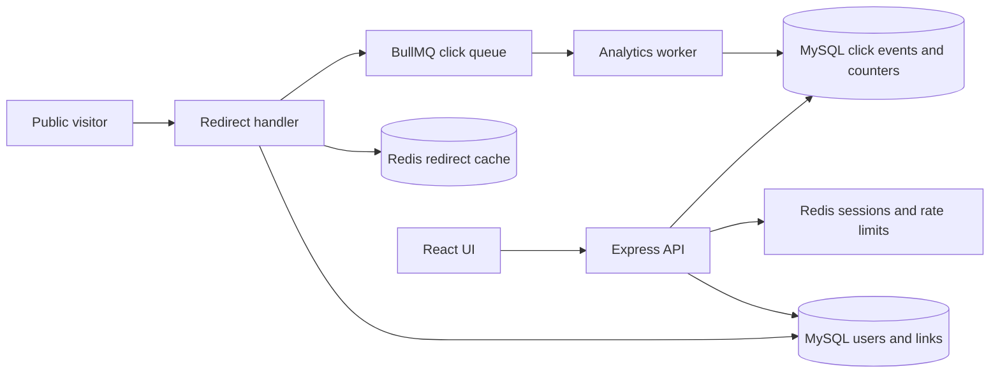

# ZipLink

ZipLink is a URL shortener built with React, Express and MySQL. This implementation extends the original application with account-owned link management, shared Redis sessions, cache-aside redirects and asynchronous click analytics. It is a production-oriented learning project; deployment hardening and environment-specific verification remain explicit requirements, not implied guarantees.

## Implemented features

- Registration, login, logout and profile using bcrypt passwords and Redis-backed HTTP-only sessions.
- Synchronizer-token CSRF protection, exact-origin credentialed CORS, Helmet headers, bounded JSON requests and shared Redis fixed-window rate limits.
- HTTP(S)-only URL validation, consistent WHATWG normalization, public-hostname guards and parameterized SQL.
- Cryptographic unbiased Base62 codes, database-enforced case-sensitive uniqueness, bounded collision retries and custom aliases.
- Owner-only create/list/detail/update/delete, enable/disable, optional expiration, search/status filters and cursor pagination.
- Preserved legacy public redirects, compact `/:shortCode` redirects, expiry/state enforcement and soft-delete tombstones.
- Redis cache-aside reads, short negative caching, TTL-bounded stale state, best-effort invalidation, per-process miss coalescing and MySQL fallback.
- BullMQ click producer and separate worker; retry/backoff, retained failed jobs, transactionally idempotent event storage and click counters.
- Owner-only daily analytics, devices, browsers, referrers and top links, with responsive React/Recharts daily and weekly views.
- Resumable versioned migrations, automated Node/Supertest tests, OpenAPI and repeatable k6 scripts.

## Stack and architecture

| Layer             | Tools and reason                                                                                            |
| ----------------- | ----------------------------------------------------------------------------------------------------------- |
| UI                | Existing React 19, Vite, React Router; Recharts for responsive analytics                                    |
| HTTP              | Express 5 modular monolith; controllers/services/repositories                                               |
| Persistence       | MySQL 8/InnoDB, pooled mysql2 parameterized queries                                                         |
| Sessions/security | express-session + connect-redis, bcryptjs (bcrypt), Helmet                                                  |
| Cache/rate state  | node-redis; shared fixed-window Lua counters                                                                |
| Analytics         | BullMQ/Redis with explicit ioredis queue driver, separate Node worker, ua-parser-js metadata categorization |
| Operations/tests  | Pino/Pino HTTP, Node test runner, Supertest, Prettier, ESLint, k6                                           |



The API is one modular monolith; only analytics processing has a separate process. See [architecture and failure analysis](docs/ARCHITECTURE.md), [initial audit](docs/IMPLEMENTATION_PLAN.md), and [benchmark procedure](docs/BENCHMARKS.md).

## Local setup

Use Node.js 22.12+ or 24 LTS, MySQL 8+, Redis 7+ and npm. Docker Compose is optional. Keep MySQL and Redis private. The sample Compose file binds only loopback, persists volumes and enables Redis AOF with `noeviction`; it is a local development setup, not a hardened production deployment.

1. Install dependencies with `npm install` (`npm.cmd` in PowerShell if script execution is restricted).
2. Copy `.env.example` to `.env` without replacing an existing configuration. Generate a random session secret with `node -e "console.log(require('crypto').randomBytes(48).toString('hex'))"`. Replace all placeholder credentials. Never commit `.env`.
3. For Compose, also set `MYSQL_ROOT_PASSWORD` in `.env` and run `docker compose up -d`. For existing services, set connection values in `.env` and create a database with a migration-capable account. Do not point an integration test at an existing database.
4. Back up an existing database and run `npm run migrate`. Review [migration details](#database-and-migration) first.
5. In separate terminals run:

```sh
npm run server
npm run worker
npm run dev -- --port 5173 --strictPort
```

Open `http://localhost:5173`. Use `localhost` consistently for frontend and API cookies. The API is `http://localhost:5002`. If changing the frontend port/hostname, update the exact origin in `FRONTEND_ORIGINS`. The frontend build requires SPA route fallback when hosted separately.

### Environment configuration

| Variable                                 | Default / requirement                                                                   |
| ---------------------------------------- | --------------------------------------------------------------------------------------- |
| `SESSION_SECRET`                         | Required, at least 32 characters; use random secret material                            |
| `NODE_ENV`                               | Set `production` for Secure cookies and HTTPS origin validation                         |
| `PORT`                                   | `5002`                                                                                  |
| `PUBLIC_BASE_URL`                        | `http://localhost:5002`; API/public redirect origin, HTTPS in production                |
| `FRONTEND_ORIGINS`                       | `http://localhost:5173`; comma-separated exact origins, HTTPS in production             |
| `VITE_API_URL`                           | Frontend API origin, defaults to `http://localhost:5002`; rebuild/restart after changes |
| `DB_HOST`, `DB_PORT`                     | `127.0.0.1`, `3306`                                                                     |
| `DB_USER`, `DB_PASSWORD`, `DB_NAME`      | `ziplink`, empty password, `url_shortener`; provide real credentials                    |
| `DB_POOL_SIZE`                           | `10`, bounded 1-100, waiting queue capped at 100                                        |
| `REDIS_URL`                              | `redis://127.0.0.1:6379`; use authenticated TLS Redis in production                     |
| `REDIS_PREFIX`                           | `ziplink`; isolates this deployment's keys, not a security boundary                     |
| `SESSION_TTL_SECONDS`                    | `86400`; absolute authenticated lifetime, at most 7 days                                |
| `SHORT_CODE_LENGTH`, `COLLISION_RETRIES` | `8`, `5`                                                                                |
| `CACHE_ENABLED`, `CACHE_TTL_SECONDS`     | `true`, `60` (max 3600)                                                                 |
| `NEGATIVE_CACHE_TTL_SECONDS`             | `5` (max 60)                                                                            |
| `BCRYPT_ROUNDS`, `WORKER_CONCURRENCY`    | `12`, `5`                                                                               |
| `TRUST_PROXY`                            | Unset/false; set only actual trusted proxy ranges, never blindly trust client headers   |
| `LOG_LEVEL`                              | `info`                                                                                  |
| `MYSQL_ROOT_PASSWORD`                    | Required only for the sample Compose MySQL container                                    |

Prefer the same site for UI/API in production (e.g. app.example.com and api.example.com); cookies use SameSite=Lax. Unrelated sites are not supported by the current cookie policy. TLS must terminate at a properly trusted proxy when the Node process does not itself serve TLS.

## Redirect and analytics flow

1. Public GET `/api/short/:shortCode` or `/:shortCode` applies the generous per-IP shared limit and bypasses sessions.
2. A cache hit returns the cached destination/state. A miss reads MySQL and populates Redis. A nonexistent code receives a short negative TTL. Concurrent misses for the same key are coalesced within one API process.
3. Every resolution checks disabled/deleted/expiry state, including on cache hits. Healthy links return 302 with `Cache-Control: no-store`; unavailable links return 410 and unknown links return 404. HEAD requests do not produce events.
4. The producer attempts to enqueue a generated event ID, link ID, timestamp, device/browser category, referrer hostname and bot flag. It never fetches the destination. The HTTP response does not wait for the queue or analytics SQL write.
5. The worker validates events and locks the link in a transaction. A unique event insert and click-counter increment commit together. Duplicate deliveries do not increment twice. Retries use exponential backoff, up to 5 attempts. Failed jobs remain bounded in Redis for investigation.
6. Analytics APIs query MySQL aggregates, and the UI refreshes on request. Data is eventually consistent. Detected bots are included and reported separately. No raw IP, raw user agent, referrer path or query string is persisted.

A successful redirect is distinct from queue acceptance, database persistence and counter inclusion. When Redis/queue is unavailable, public redirects favor availability and events may be lost. Logs and counters expose drops. Pending producer work can also be lost on process crash. This is at-least-once worker processing for accepted durable jobs, not exactly-once delivery. Redis durability depends on persistence/replication configuration.

Cache invalidation is best effort after a database write. Multi-instance races or outages can retain old state until TTL expires (60 seconds by default). Deleted links cannot remain cached indefinitely, but immediate revocation is **not** guaranteed. A future strict-revocation design must add an authoritative state check or coordinated versioning/invalidation.

## Authentication and security

Fetch GET `/api/auth/me` with a cookie jar first; it returns `{ user, csrfToken }`, including for anonymous visitors. Include that token in `X-CSRF-Token` on every write. Registration/login rotate session IDs and tokens; logout destroys the stored session. Authentication is required for all link management and analytics. Owner predicates prevent reading or mutating another user's link, returning 404 rather than exposing its existence.

Passwords have a 12-character minimum and 72 UTF-8 byte maximum to avoid bcrypt truncation. Cookies are HTTP-only, SameSite=Lax and Secure in production. Secrets/passwords/cookies are excluded from structured request logs. Request bodies are capped at 16 KB. IP literals, local/internal hostname suffixes, credential-bearing URLs and non-HTTP(S) schemes are rejected. WHATWG normalization lowercases host/scheme and removes default ports; path/query ordering and fragments are preserved. Aliases are case-sensitive; reserved route names are rejected case-insensitively.

This is not phishing detection or a complete public-DNS safety policy. Hostnames can resolve privately or change DNS answers. Since ZipLink does not fetch destinations, it does not expose a server-side fetch SSRF path. Any future preview/fetch feature must validate DNS and each redirect hop, block nonpublic ranges, and constrain network egress. Reputation services, moderation, reports, email verification and account recovery are future work.

| Policy             | Fixed window and identity                        | Redis outage              |
| ------------------ | ------------------------------------------------ | ------------------------- |
| Login              | 10 / 15 minutes, IP, including signed-in callers | Fail closed, 503          |
| Registration       | 5 / hour, IP                                     | Fail closed, 503          |
| Creation           | 30 / minute / user, plus management policy       | Fail closed, 503          |
| Management/profile | 300 / minute / user or anonymous IP              | Fail closed, 503          |
| Public redirects   | 6000 / minute / IP                               | Fail open, MySQL fallback |

Limits use atomic Redis INCR + PEXPIRE Lua operations shared by API replicas. Over-limit responses return 429 and `Retry-After` seconds. This fixed-window variant starts the TTL at the first request and permits boundary bursts. It is not sliding-window or token-bucket limiting. NAT clients share an IP quota; trusted proxy settings affect correctness.

## Database and migration

`npm run migrate` applies numbered migrations under a MySQL advisory lock and records successful versions. MySQL DDL autocommits; steps check schema state so interrupted migrations can resume. Take a backup: there is no automated down migration, and large ALTERs may lock/copy tables. Migrate in a planned deployment window. Runtime API credentials should have only needed DML privileges; the migration account needs DDL. Integration tests need CREATE/DROP DATABASE on generated test databases.

Existing `urls` rows and counters remain. NULL counters become 0. Legacy ownership is NULL and is never auto-claimed. Existing public redirect paths stay valid for permitted HTTP(S) destinations. Invalid, non-HTTP(S) or credential-bearing legacy destinations now return 410 without rewriting or deleting records; this is an intentional security change. Older valid HTTP(S) hostname destinations should still be reviewed separately by an operator. Old global duplicate-destination behavior is removed: different links may have the same destination. The old management endpoints remain compatibility aliases but now require login and return only owned rows. Alias edits and anonymous creation are intentionally not supported.

| Table/index                                                | Purpose and cost                                                                                         |
| ---------------------------------------------------------- | -------------------------------------------------------------------------------------------------------- |
| `users` / unique email                                     | Normalized account lookup; password hashes only                                                          |
| `urls` / unique `short_code` (ASCII binary)                | Point lookups and concurrency-safe shared code namespace; one unique-index write per creation            |
| `urls` / `(user_id, deleted_at, created_at DESC, id DESC)` | Owner-specific non-deleted keyset listing, no offset scan; extra storage/write cost                      |
| `urls` / `(created_at, id)`                                | Operator creation-time scans, not used to accelerate destination substring search                        |
| `urls.user_id` FK                                          | ON DELETE RESTRICT: accounts cannot silently cascade away public links                                   |
| `click_events.event_id` PK                                 | Idempotent event identity; UUID index/storage overhead                                                   |
| `click_events` / `(link_id, occurred_at)`                  | Link/time analytics and FK; writes maintain both event indexes                                           |
| `click_events` / `(occurred_at, link_id)`                  | Bounded-range reporting candidate index; optimizer may choose owner-first joins depending on selectivity |

Event FK deletion is CASCADE if an operator physically removes a link. The API only soft-deletes links, retaining code tombstones and preventing reuse. Events are not purged automatically; define retention before a real deployment. Account deletion/export and anonymization workflows are not implemented. Search is a bounded owner-scoped literal substring scan; time ranges limit analytics queries, but high event volume still needs EXPLAIN, retention and/or rollups.

## API documentation

The tracked [OpenAPI specification](server/openapi.json) is also served at `/api/openapi.json`. Regenerate it with `node scripts/generate-openapi.js` after API changes. Success responses use `{ success: true, data }`; lists also return `{ pagination: { hasMore, nextCursor } }`. Errors use `{ success: false, error: { code, message, requestId } }`. Follow `nextCursor` with unchanged filters; new records inserted ahead of a cursor do not shift later pages.

```http
GET /api/auth/me
```

Keep the returned cookie and CSRF token. After login, use the replacement token:

```http
POST /api/links
Content-Type: application/json
X-CSRF-Token: <current-token>
Cookie: <session-cookie>

{"originalUrl":"https://example.com/a/long/path","alias":"Launch-2027","expiresAt":"2030-01-01T00:00:00Z"}
```

The response contains a link object with `id`, `original_url`, `short_code`, `short_url`, `enabled`, `expires_at`, `clicks`, and timestamps. Creation returns 201, updates 200, alias conflicts 409, malformed input 400, missing authentication 401, failed CSRF 403, owner mismatches 404. See the specification for all fields and endpoints.

## Tests, checks and operational commands

```sh
npm test
npm run test:integration -- mysql
npm run test:integration -- redis
npm run test:integration -- all
npm run lint
npm run format:check
npm run build
npm run loadtest -- --check
npm run loadtest
npm run queue:status
npm run queue:status -- retry JOB_ID
```

Default tests skip live infrastructure tests. MySQL integration creates a random `ziplink_test_<uuid>` database, seeds the original schema, runs migrations twice, checks real concurrent inserts/transactions/pagination/auth, and drops only that database in `finally`. It never truncates a configured database. Redis integration uses a unique prefix; it never FLUSHes shared state. Do not run it on a production Redis service. Completed/failed jobs have bounded retention. Retry failed jobs only after diagnosing the cause; database idempotency prevents repeated counting for the same event ID.

Verification performed on 7 November 2026: 31 unit/HTTP/configuration tests and all 3 real-service integration suites passed against MySQL 8.0.46 and temporary Redis 7.4.2. The real browser flow verified cookie/CSRF registration, alias creation, redirect, persisted chart data and logout. Build, lint and formatting passed. Exact evidence and limits are in [verification notes](docs/VERIFICATION.md). A paced local load test also passed: roughly 48 req/s at 10 VUs and 96.6 req/s at 20 VUs, with zero workload errors; see [measured results](docs/LOAD_TEST_RESULTS.md) and [benchmark procedure](docs/BENCHMARKS.md). Maximum capacity, outage-load behavior and the original synchronous baseline remain unmeasured.

## Known limits and next steps

- Production HTTPS cookie/proxy behavior, Redis crash recovery and controlled fault/load behavior need deployment-level verification.
- Best-effort cache invalidation allows bounded stale redirects after edits/deletion. Analytics may lose events before queue acceptance, on Redis data loss, or at producer crash; no durable outbox is implemented.
- A shared Redis instance couples sessions, limits, cache and queue availability. Use `noeviction`, monitor memory, and consider separate instances/policies before scaling.
- Raw-event aggregation is bounded by date but not precomputed. Each persisted click writes an event and updates one link row, which can become a hot-row bottleneck.
- No maximum-capacity, HA, multi-region failover, tracing exporter, alert pipeline, automated backups, retention job, CI/CD or production deployment is claimed.
- Next priorities: live failure drills, recovery/backups, reputation/moderation, email verification/recovery, retention, query-plan profiling, rollups, durable ingestion/outbox where required, and QR/export tools.

Author: **Kaushik Mishra**, B.Tech. Computer Science and Engineering, National Institute of Technology, Raipur.

## Project structure

```text
src/                     Existing React frontend, extended in place
  components/            Shared UI, link editor, auth guard and metric cards
  context/               Session state and authentication actions
  lib/api.js             Credentialed requests, coalesced session bootstrap, CSRF
  pages/                 Home, History, Login/registration and Analytics
server/
  server.cjs             Compatible original entry point
  src/                   App factory and API startup
    config/              Environment, pools/Redis, migrations
    controllers/         HTTP handling
    services/            Link policy and redirect cache
    repositories/        MySQL access and transactions
    routes/              API route composition
    middleware/          CSRF, authentication and rate limits
    validators/          URL, credentials, cursor and event validation
    queues/              BullMQ producer
    workers/             Separate analytics process
    utils/               Base62 and application errors
  migrations/            Numbered resumable schema changes
  tests/                 Unit, HTTP, MySQL, Redis and combined pipeline suites
  openapi.json           Served API contract
scripts/                 Integration runner, spec generation, queue operations
benchmarks/              Current authenticated k6 scenarios
docs/                    Audit, architecture, benchmarks and verification
docker-compose.yml       Optional loopback-only local MySQL/Redis
.env.example             Configuration template; real .env stays ignored
```
