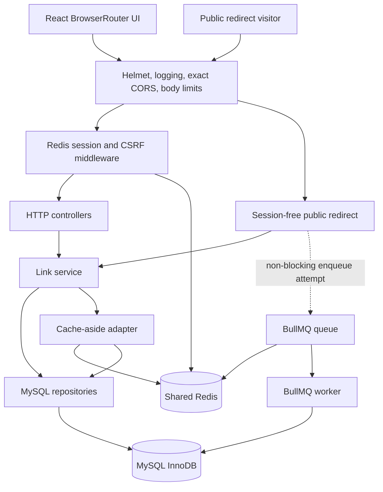
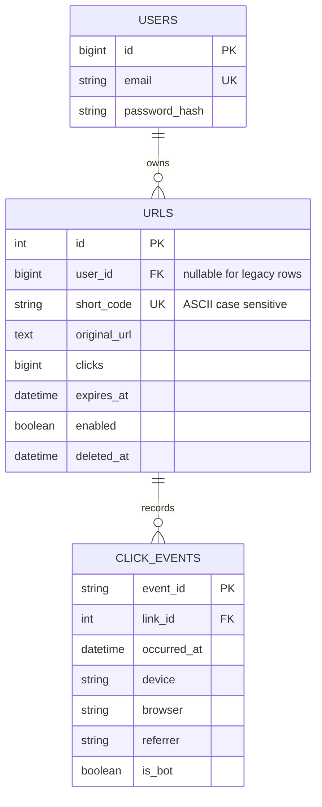
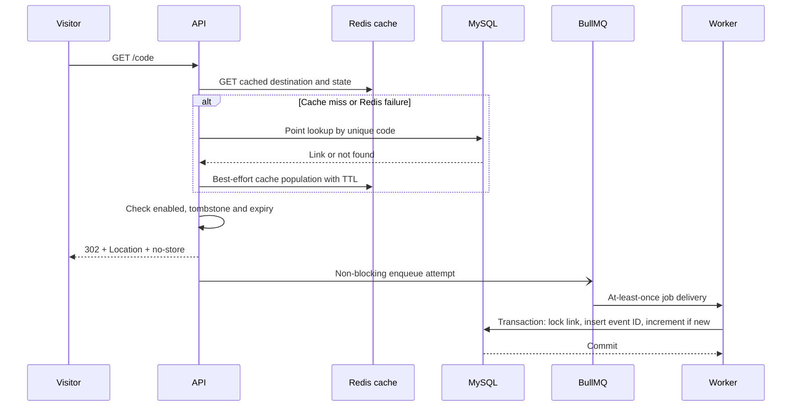

# Architecture and engineering decisions

## Components and boundaries

ZipLink extends the existing React/Vite and Express/MySQL application. It is a modular monolith with a separately deployed analytics worker, not a microservice fleet. The original `server/server.cjs` entry point imports the new ES-module API. One root package/lockfile avoids duplicated dependency management.

| Source                                              | Responsibility                                                               |
| --------------------------------------------------- | ---------------------------------------------------------------------------- |
| `server/src/config/env.js`                          | Fail-fast environment validation, origins, connection/pool limits            |
| `server/src/app.js`                                 | Express app factory, middleware order, public/session routing, errors        |
| `server/src/controllers`                            | Parse HTTP inputs and shape responses; no raw SQL                            |
| `server/src/services/links.js`                      | Allocation retries, ownership, lifecycle and redirect eligibility            |
| `server/src/repositories`                           | Parameterized persistence, keyset listing, event transactions, aggregate SQL |
| `server/src/services/cache.js`                      | TTL cache-aside, negative caching, per-process single-flight, invalidation   |
| `server/src/middleware/security.js`                 | Synchronizer CSRF, owner authentication guard, shared atomic limits          |
| `server/src/queues/analytics.js`                    | Bounded pending enqueue attempts and distinct acceptance/drop counters       |
| `server/src/workers/analytics.js`                   | Separate worker, retry/error logs, graceful drain                            |
| `server/migrations`, `server/src/config/migrate.js` | Versioned resumable DDL with advisory migration lock                         |
| `src/context`, `src/lib/api.js`                     | Frontend session, cookie/CSRF transport, centralized API errors              |
| `src/pages/Analytics.jsx`                           | Lazy-loaded API-driven charts; UTC daily and Monday-based weekly grouping    |

The app factory injects repositories, sessions, Redis and producers for testing. There is no general-purpose dependency injection framework. Memory session/repository implementations exist only in tests; production always uses MySQL and Redis.

## Data model

NULL ownership preserves legacy redirects without inventing ownership. Users cannot claim them through registration or a URL match. User deletion is RESTRICT; physical URL deletion cascades events, but normal API deletion retains a tombstone. This prevents reuse of a formerly shared code. A future account deletion/privacy workflow requires an explicit product and retention decision.

The existing unique short-code index becomes ASCII binary, so `Launch` and `launch` differ. Generated Base62 codes and aliases use that same unique index. `crypto.randomInt(62)` avoids modulo bias. A conflicting generated code is retried at most five times; a conflicting explicit alias returns 409. A preliminary SELECT cannot serialize two concurrent INSERTs; the unique constraint decides the winner.

The owner/undeleted/creation/id composite index matches listing predicates and stable descending keyset order. The cursor contains the final creation time and ID; it is validated but not a credential. Ownership remains a separate query predicate. A cursor is valid only with the same filters; it is not a point-in-time snapshot. Concurrent deletion can remove rows and concurrent updates can change filter membership. Substring search is owner-bounded but not accelerated by a B-tree over the destination.

Event indexes support `(link_id, occurred_at)` link reports and `(occurred_at, link_id)` time-bounded reports. These are candidate access paths, not a measured claim that every query uses them. Use EXPLAIN ANALYZE on realistic distributions. Every extra index adds write/storage cost. Counter totals and raw event details differ for legacy clicks that have no historic event records.

## Authentication and trust boundaries

The frontend first calls `/api/auth/me`, receiving a cookie-backed session and random CSRF token. Writes must include that token. Registration and login hash/verify passwords with bcrypt, regenerate the session to prevent fixation, and issue a replacement token. Redis stores session data; the cookie contains only a signed opaque ID. Cookie TTL and an explicit authenticated expiration bound lifetime; logout destroys the server record. Session rotation and invalidation are shared across API instances.

HTTP-only cookies reduce script access to credentials; they do not prevent an XSS payload from issuing requests. SameSite=Lax and CSRF checks address cross-site requests. Exact-origin CORS controls browser response access; it is not authentication and does not protect curl clients by itself. Production requires HTTPS for frontend/public origins and Secure host-only cookies. Proxies must be trusted by actual network ranges for cookie security and rate identity; arbitrary forwarded IP headers must not become trusted.

All management queries include `user_id` and reject unowned IDs with 404. Public redirect paths precede session middleware, preserving read availability during a session-store outage. Legacy aliases `/api/shorten` and `/api/urls` intentionally stop being anonymous management APIs.

Destination policy uses WHATWG URL normalization, retains query ordering/fragments, and rejects unsafe schemes, embedded credentials, IP literals, local suffixes, control characters and overlong input. No server-side network fetch occurs. Public DNS names may resolve internally or change answers: this guard is not sufficient for a future HTTP preview fetcher. Phishing/reputation/moderation and stricter operator review of legacy destinations remain external/future responsibilities.

## Redirect and cache flow

The logical redirect response does not wait for analytics; the enqueue attempt is initiated before response completion and can resolve before or after it. A maximum of 500 pending producer promises limits local memory; overflow is counted/logged and loses events. Queue calls have fast-failure connection options. Workers persist/retry rather than using producer fail-fast settings.

Cache-aside means application code reads Redis, queries MySQL on miss and fills Redis. Negative results have a short TTL to reduce repeated absent-code queries. Cache expiry is capped by link expiry and eligibility is checked again on every hit. Per-process pending-promise coalescing (bounded to 1000 entries) reduces duplicate concurrent misses, but does not serialize different API replicas. There is no distributed miss lock.

After a mutation commits, the API best-effort deletes the cache entry. If invalidation fails, cached state may remain until the TTL. A read that began before a write can also fill old state after deletion. Creation invalidates any negative entry, subject to the same race. This implementation is eventually consistent and offers TTL-bounded staleness, not immediate revocation. Strict immediate deletion would require authoritative checks or a coordinated version/tombstone strategy on every replica; document the availability/latency trade-off before changing it.

Alternative cache patterns: read-through hides miss loading behind a cache API; write-through synchronously updates cache with writes; write-behind asynchronously persists cache writes. Neither write-through nor write-behind is implemented. MySQL remains authoritative. Redis uses TTLs for cache entries but `noeviction` for the combined session/queue deployment. At memory exhaustion, commands may fail; monitor capacity and consider separate cache and durable operational Redis instances.

## Event processing and reporting

Events include UUID, link ID, ISO timestamp, bounded categorical device/browser, referrer hostname and a heuristic bot flag. Raw IPs, user agents, query strings and referrer paths are not stored. Referrer hostnames can still be identifying, and queues/logs are part of the privacy boundary. Approximate geography is deliberately not implemented. No automatic event-retention job is present; define a retention/deletion policy before deployment.

The worker validates each event, locks the target link, skips deleted links and inserts a unique event ID plus counter update in one transaction. Retrying after a commit but before acknowledgement is safe: the duplicate insert affects zero rows and does not increment. This provides idempotent effects, not exactly-once transport. Events for links deleted before processing are intentionally skipped. Enabled/expiry changes do not discard an event for a redirect that already happened.

Jobs retry five times with exponential backoff from 1 second. Failed jobs are retained up to seven days / 10000 jobs; completed jobs up to one day / 10000. The database idempotency record outlives completed queue jobs. Operator CLI exposes backlog and job retry; there is no automatic DLQ or alert pipeline. Worker shutdown drains active processing with a 30-second process deadline. A hard shutdown may cause redelivery, handled idempotently.

Reports aggregate SQL over a maximum 366-day range and return bounded top-10 categories/links. Daily groups use UTC. Weekly chart grouping sums fetched daily counts client-side; no raw events are loaded into browser memory. Bots are included in totals and separately counted using a heuristic that can miss or misclassify traffic. Raw events provide flexible dimensions but query cost grows with data; rollup tables would trade freshness/flexibility for cheaper reads. The lifetime counter introduces a hot-row write per event.

## Failure policy and observability

| Failure                              | Observed behavior / limitation                                                                              |
| ------------------------------------ | ----------------------------------------------------------------------------------------------------------- |
| Redis cache unavailable at runtime   | Read MySQL; log cache errors. Public rate limiting fails open.                                              |
| Redis session/rate state unavailable | Management fails closed with 503; no in-memory production fallback.                                         |
| Queue cannot accept event            | Redirect succeeds, drop counter and error log; no durable outbox/replay guarantee.                          |
| Worker stopped                       | Accepted Redis jobs accumulate; redirects continue until capacity/service limits intervene.                 |
| Worker transient SQL failure         | Transaction rollback; queue retries with backoff. Exhausted jobs retained for operator action.              |
| MySQL unavailable                    | Cache misses and management fail; valid cached redirects may continue until TTL. Readiness returns 503.     |
| Invalidation failure                 | Stale redirect destination/state possible until cache TTL; failure counter/log.                             |
| API crash before enqueue acceptance  | Event can be lost. Redirect response may already have succeeded.                                            |
| Redis data loss                      | Sessions and queue entries can be lost, even if accepted; AOF/replication reduce but do not eliminate risk. |

Structured logs include request IDs, method, path and status; request bodies, passwords, full query strings, cookies and tokens are not logged. API counters are emitted every 30 seconds per process: cache hits/misses/errors, invalidation failures, redirect count, queue acceptance/drops and limiter errors. Queue counts are inspected separately. There is no Prometheus exporter, tracing pipeline or alert configuration; these are future integration tasks.

Fixed-window rate policies use atomic INCR/PEXPIRE Lua counters. Windows begin on the first request and permit bursts around expiry. Sliding windows account for recent arrivals more precisely at higher state/CPU cost; token buckets permit controlled bursts while refilling a steady budget. Only fixed windows are implemented. Public limits are intentionally generous to avoid suppressing normal hot links, but shared-IP/NAT fairness and attacker IP rotation remain limits.

## Verification and capacity limits

See `docs/VERIFICATION.md` for exact executed checks and service limitations, and `docs/BENCHMARKS.md` for repeatable load/fault experiments. MySQL tests use real isolated databases; unit/API tests inject MemoryStore/repositories strictly for tests. No throughput or high-scale guarantee follows from passing correctness tests.

There is no HA MySQL/Redis topology, read replica, sharding, durable outbox, regional routing or distributed cache-coherence protocol. API replicas can share MySQL/Redis and sessions; local single-flight and counters remain per process. Worker scaling is bounded by MySQL pool/write contention and hot link counters. At higher traffic, profile first, then consider batch/rollup processing, event-retention partitions, split Redis workloads, replication and regional read design. These are potential changes, not existing features.

## Time and frontend session correctness

Every production MySQL pool connection explicitly sets `time_zone = '+00:00'` before its first application query. The mysql2 `timezone: 'Z'` option alone only affects JavaScript conversion and does not change the MySQL session timezone, which matters for legacy TIMESTAMP fields and `CURRENT_TIMESTAMP`. Event/expiry DATETIME values are written as UTC and the UI interprets database datetime strings as UTC. The real MySQL integration test verifies the session setting.

Frontend session bootstrap requests are coalesced while in flight. This prevents React StrictMode or simultaneous unauthenticated writes from creating competing anonymous cookies/CSRF tokens. CSRF rotates with authentication and is cleared after logout or a CSRF rejection. Previously displayed home results/statistics are scoped to the current account so a later account cannot inherit the prior account's UI state. Copy feedback is scoped to the link text rather than persisting a misleading copied label after text changes.

Legacy HTTP(S) redirects remain functional, but invalid, non-HTTP(S), or credential-bearing legacy destinations now return 410 without rewriting/deleting their stored records. This is an intentional security change: a migration must not keep unsafe redirect schemes active. Operators should review legacy public-hostname policy separately; the stricter new-link hostname rules are not retroactively applied to old valid HTTP(S) links.
